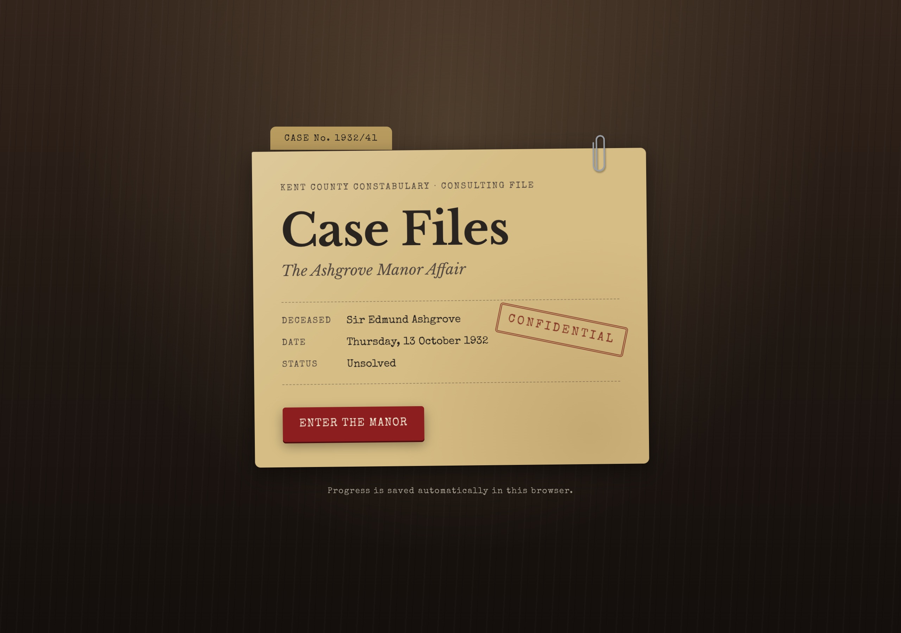
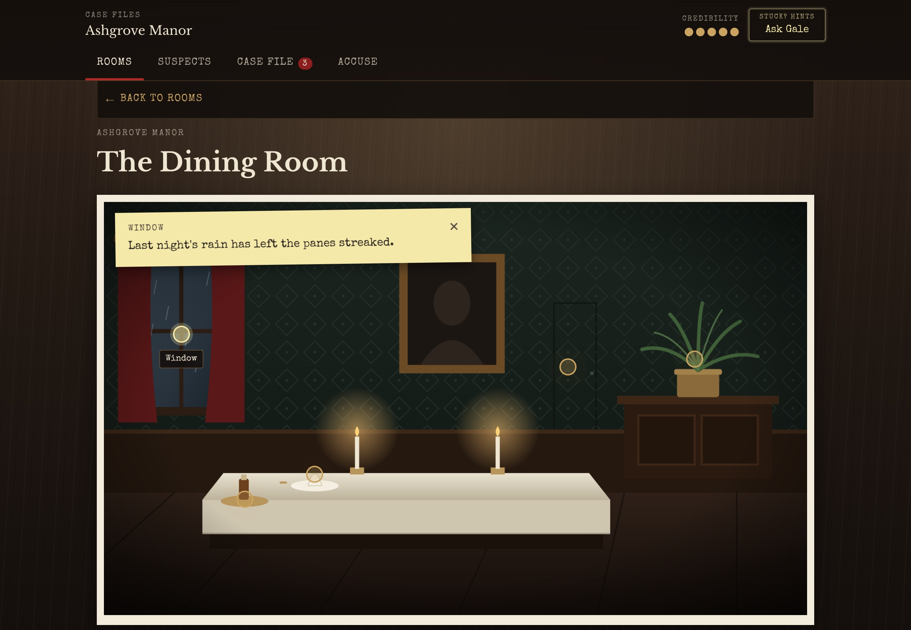
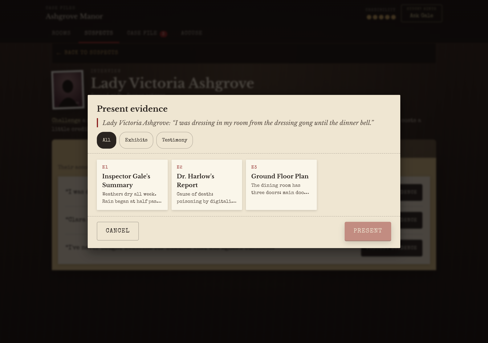
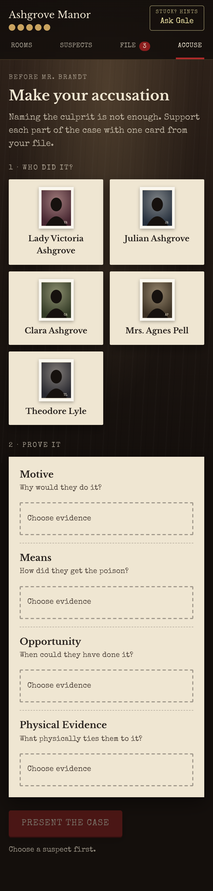
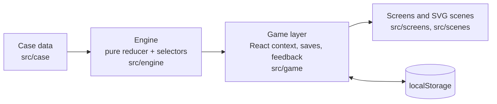

# Case Files: The Ashgrove Manor Affair

_A 1932 country-house murder mystery for the browser. Search the manor, question the household, catch their lies with evidence, and prove your case before the solicitor arrives._



### ▶ [Play Case Files in your browser](https://case-files-ruby.vercel.app/)

Free to play on desktop and mobile. No sign-up or download. Progress saves automatically.

## About the game

Kent, October 1932. Sir Edmund Ashgrove collapses at his own dinner table and dies before the doctor arrives. The family solicitor is due at ten the next morning. By then, you need to know who did it, and be able to prove it.

Case Files is one complete detective case, designed for a 20–30 minute session. There are no multiple-choice answers. You gather evidence, catch suspects in statements that the evidence contradicts, and build a case that has to stand up on its own.

## How to play

- **Search the rooms.** Tap a glowing point or pick from the list under each room. Anything important goes into your Case File.
- **Question the household.** Ask about topics, or **challenge a statement** by presenting evidence that contradicts it.
- **Mind your credibility.** A wrong challenge costs a little. It never stops the investigation, but it affects your final rating.
- **Ask Inspector Gale** when you're stuck. Hints start vague and become clearer if you ask again.
- **Make your accusation.** Name the culprit, then support the case with a motive, the means, the opportunity and physical evidence.

## Screenshots


_Searching a room: every glowing point can be examined, and observations appear right on the scene._


_Challenging a statement: present any card from your Case File to test what a suspect has told you._

### Responsive Design

<p align="center">
  
</p>

_The whole game is playable on phones down to 320px wide. Shown here: the accusation screen on a 390px-wide phone._

## Features

**Gameplay**
- Five suspects, each with their own account of the evening and topics to ask about.
- **Press the statement:** challenge any statement with any card from your Case File. Catching a lie can reveal new testimony and new questions.
- **A four-part accusation:** naming the right person isn't enough. The motive, means, opportunity and physical evidence must each be supported, and weak cases get specific feedback.
- Tiered hints, soft penalties and unlimited retries, so a player can never get permanently stuck.
- Announcements when new rooms, places to search, or questions become available.

**Save and Continue**
- Progress saves automatically in the browser and survives a refresh or a closed tab.
- Continue, New Game and Play Again, with confirmation before any progress is replaced.
- Saves are versioned and validated against the case data, so corrupted or incompatible saves are ignored safely.

**Design and accessibility**
- A hand-built "desk-noir" look: illustrated SVG rooms, paper and manila-folder components, typewriter and serif type, no image assets.
- Responsive from desktop down to 320px phones.
- Fully playable by keyboard. Dialogs keep focus inside and return it on close, and focus stays visible on both dark and paper surfaces.
- Text contrast checked against WCAG AA, 44px touch targets, screen-reader announcements, and support for reduced-motion settings.

## How it's built

The mystery is **data**, and the engine is **pure logic** that knows nothing about the story.



| Folder | Responsibility |
|---|---|
| `src/engine` | Framework-free TypeScript: types, the game reducer, unlock rules, accusation judging, case validation and reachability analysis |
| `src/case` | The Ashgrove Manor case as typed data: evidence, rooms, suspects, statements, topics, hints and story text |
| `src/game` | The bridge to React: game context, versioned saves, player-facing feedback and announcements |
| `src/screens`, `src/components` | The interface: rooms, interviews, Case File, accusation, ending, dialogs |
| `src/scenes` | Inline SVG illustrations of each room |
| `src/styles` | Design tokens and shared styles |

**Key design decisions**
- **The engine reads a script.** Every clue, statement and unlock lives in one typed data file. A new case would be new data, not new code.
- **One unlock rule.** Everything that can be locked is gated by a declarative condition, checked by a single function. Conditions only ever *add* access, so nothing can lock the player out.
- **Solvability is tested, not assumed.** Because unlocks only add access, an explorer that takes every available action until nothing changes reaches everything a player could. Tests use it to confirm that every clue, contradiction and hint is reachable.
- **Proving, not guessing.** Accusations are judged by a pure function that checks each part of the case separately, which makes the rules easy to test.
- **Safe saves.** A save is a versioned snapshot checked against the case data on load, and autosave only starts after the player chooses Continue or New Game.

React handles the view. Everything else (state, routing between screens, persistence, styling) is plain TypeScript and CSS, with no runtime dependencies beyond React.

## Testing

Unit tests run with [Vitest](https://vitest.dev):

```bash
npm test
```

They cover:
- the engine's rules: unlocking, presses, credibility and accusations
- consistency between the case data and its design document
- exhaustive solvability: every clue, contradiction and hint reachable, every valid accusation provable
- save validation, version handling and start-up safety
- player-facing feedback and announcements

The responsive layouts, keyboard navigation and accessibility were also checked in Chrome at desktop, tablet and phone widths during development.

## Getting started

**Prerequisites:** Node.js 20 or 22+ (developed on 20.13) and npm.

```bash
npm install
npm run dev        # start the dev server at http://localhost:5173
npm test           # run the unit tests once
npm run build      # type-check and build into dist/
npm run preview    # serve the production build
```

The build uses relative asset paths, so `dist/` works on any static host, including from a subfolder.

## Project status

The game is complete and live at **[case-files-ruby.vercel.app](https://case-files-ruby.vercel.app/)**, deployed on Vercel from this repository. Not yet available:
- **More cases:** the engine supports them, but there is only one case and no case selection.
- **Language and sound:** English only, no audio.
- **Cloud saves:** progress is stored in one browser on one device.
- **Very small phones:** a few neighbouring hotspots have overlapping tap areas. The list under each room is always the precise alternative.

## Spoiler warning

`docs/` and `src/case/` (including its tests) contain the full solution. Play the game first.

## Tech stack

React 18 · TypeScript · Vite 6 · Vitest · plain CSS with design tokens · inline SVG · Google Fonts (Libre Baskerville, Special Elite, Inter)

## Development Approach

**This is a vibe-coded project built with Claude Code.**

I used AI to implement the game while taking responsibility for its overall direction, gameplay requirements, design decisions, reviewing implementations, and testing outcomes.

The project was developed iteratively through planning, implementation, review, and refinement across seven milestones.

## Copyright

Copyright © 2026. All rights reserved. This project is publicly available for viewing and evaluation. No permission is granted to copy, modify, or redistribute the code without prior authorisation.
